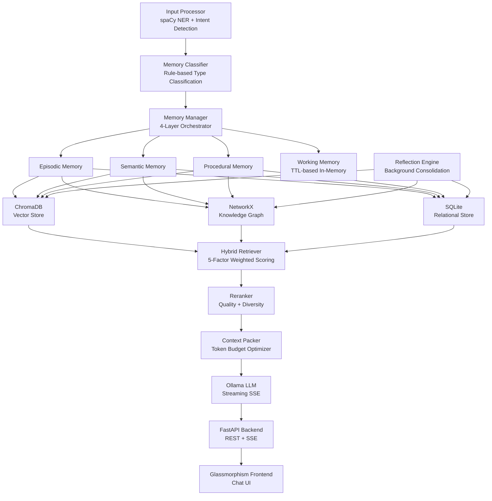

# 🧠 Cognitive AI Memory System — Deep Analysis

## Part 1: Memory Visibility Problem

### What's Happening Right Now

You have **4 memory types** defined in your system, but the UI barely communicates them:

| Memory Type | Backend Status | Frontend Visibility |
|---|---|---|
| **Episodic** | ✅ Fully implemented, stores all chat messages | 🟡 Shows as a tiny `episodic` badge — always this type |
| **Semantic** | ✅ Implemented with deduplication | ❌ Never appears in chat (nothing gets classified as semantic) |
| **Procedural** | ✅ Implemented with workflow steps | ❌ Never appears in chat (nothing gets classified as procedural) |
| **Working** | ✅ In-memory TTL store | ❌ Completely invisible, no UI at all |

### Why Everything Shows as "Episodic"

The root cause is in [main.py:189](file:///d:/Own_project/main.py#L189):

```python
user_memory = manager.ingest(
    content=user_msg,
    source=f"chat:{conv_id[:8]}",
    memory_type=MemoryType.EPISODIC,  # ← HARDCODED!
    importance=0.6,
)
```

Every chat message is **force-classified as EPISODIC**. The classifier in [memory_classifier.py](file:///d:/Own_project/core/memory_classifier.py) is never called during chat. It's bypassed because `memory_type` is always provided.

The classifier only runs when `memory_type=None` is passed to `manager.ingest()` (see [manager.py:66-69](file:///d:/Own_project/memory/manager.py#L66)):

```python
if memory_type is None:
    memory_type = self.classifier.classify(processed["cleaned_text"])
```

### The Score Bars Are Unlabeled

The colored horizontal bars under each memory in the proof panel represent 4 retrieval scores:

| Color | Score | Meaning |
|---|---|---|
| Purple | `semantic` | Cosine similarity to query |
| Teal | `recency` | How recent the memory is |
| Yellow | `importance` | User-assigned importance × decay |
| Pink | `graph` | Knowledge graph connectivity |

But the UI shows them as **anonymous colored bars** with no legend. Only hovering reveals a tooltip (if you know to hover).

### What Needs Fixing

1. **Remove the hardcoded `MemoryType.EPISODIC`** — let the classifier decide
2. **Add a legend** to the score bars  
3. **Add a memory type breakdown** in the sidebar (not just total count)
4. **Show working memory status** somewhere visible

---

## Part 2: Resume Worthiness Assessment

### Verdict: ✅ Yes — This Is a Strong Resume Project

This is not a toy project. It demonstrates real engineering depth across multiple domains. Here's an honest breakdown:

### What Makes It Impressive



### Technical Skills Demonstrated

| Category | Specifics | Resume Impact |
|---|---|---|
| **AI/ML** | Sentence-BERT embeddings, cosine similarity, vector search, hybrid retrieval | 🔥 Very High |
| **NLP** | spaCy NER, intent classification, entity extraction | 🔥 High |
| **Systems Design** | 4-tier memory architecture inspired by cognitive science | 🔥 Very High |
| **Data Storage** | SQLite (relational), ChromaDB (vector), NetworkX (graph) — polyglot persistence | 🔥 Very High |
| **Backend** | FastAPI, SSE streaming, async lifecycle, background tasks | 🔥 High |
| **Information Retrieval** | Multi-factor scoring formula, reranking, diversity enforcement, context packing | 🔥 High |
| **Knowledge Graphs** | Entity-based auto-linking, centrality scoring, cluster detection | 🔥 High |
| **LLM Integration** | Ollama, prompt engineering, streaming token-by-token | ✅ Good |
| **Frontend** | Vanilla JS, SSE consumption, glassmorphism CSS | ✅ Good |

### How to Describe It on a Resume

> **Cognitive AI Memory System** — *Python, FastAPI, ChromaDB, SentenceTransformers, spaCy, SQLite, NetworkX*
> - Engineered a biologically-inspired 4-tier memory architecture (episodic, semantic, procedural, working) with persistent storage across SQLite, ChromaDB vector DB, and a NetworkX knowledge graph
> - Built a hybrid retrieval engine combining semantic similarity, temporal recency, importance decay, and graph connectivity into a weighted multi-factor scoring formula
> - Implemented autonomous reflection cycles for memory consolidation: duplicate merging, contradiction detection, pattern extraction, and importance decay
> - Designed a real-time chat interface with SSE streaming, context-aware LLM responses using Ollama, and visual memory proof panels showing retrieval transparency

### What Would Make It Even Stronger (for a v2)

> [!TIP]
> These are stretch goals that would elevate it from "good project" to "portfolio centerpiece":

1. **Fix the memory classification** — let the classifier actually run so all 4 types light up
2. **Add a Memory Dashboard page** — visual graph visualization (D3.js/vis.js), memory type pie chart, timeline view
3. **Add memory import** — allow uploading PDFs/notes that get chunked and ingested
4. **Docker Compose setup** — one-click deployment with Ollama + app
5. **Unit tests** — you have `tests/` and `test_chat_flow.py` but coverage matters
6. **Evaluation metrics** — measure retrieval quality (MRR, recall@k) with a test dataset

### Comparison to Typical Resume Projects

| Typical Projects | Your Project |
|---|---|
| CRUD app with React + MongoDB | Multi-storage polyglot architecture |
| "I used OpenAI API" | Custom embedding pipeline + vector DB + graph + retrieval |
| Todo app / weather app | Cognitive science-inspired system design |
| No architecture | Clean separation: `core/`, `memory/`, `storage/`, `retrieval/`, `reflection/` |

> [!IMPORTANT]
> This project demonstrates the kind of **systems thinking** that differentiates a junior from a mid-level engineer. The architecture alone (4 memory types × 3 storage backends × hybrid retrieval × reflection cycles) shows you understand how to design complex systems, not just wire APIs together.

### Bottom Line

**Yes, put this on your resume.** It's significantly above average for a portfolio project. The architecture decisions and the breadth of technologies show genuine engineering ability. The few rough edges (hardcoded memory type, unlabeled bars) are fixable in an afternoon.
