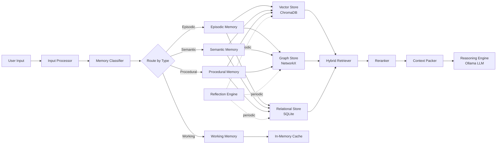

# 🧠 Cognitive AI Memory System — Complete Walkthrough

## What Was Built

A **production-grade, multi-layered cognitive memory system** with 25 files across 7 packages. Here's exactly what each layer does and how data flows through the system.

---

## System Architecture — How It All Connects



---

## The 8-Step Pipeline — Explained

### Step 1: Input Processing ([input_processor.py](file:///d:/Own_project/core/input_processor.py))

When text arrives, it goes through:

| Stage | What Happens | Example |
|-------|-------------|---------|
| **Text Cleaning** | Remove control chars, normalize whitespace/quotes | `"Hello   world"` → `"Hello world"` |
| **Chunking** | Split long text into overlapping 512-char chunks | 2000-char essay → 4 chunks with 50-char overlap |
| **Entity Extraction** | spaCy NER + noun chunk extraction | `"Resume AI for TCS"` → `["Resume AI", "TCS"]` |
| **Intent Analysis** | Keyword-pattern matching across 8 categories | `"How to build OCR"` → `"planning"` |
| **Auto-Tagging** | Generate tags from entities + intent | `["planning", "resume_ai", "tcs"]` |

### Step 2: Memory Classification ([memory_classifier.py](file:///d:/Own_project/core/memory_classifier.py))

The classifier scores text against 4 memory types using keyword + regex patterns:

```
Input: "Yesterday I discussed resume screening with the team"
  → Episodic: 3.5 (hits: "yesterday", "discussed", pattern: /\bi did|was\b/)
  → Semantic: 0.5
  → Procedural: 0.0
  → Working: 0.0
  → RESULT: Episodic ✓
```

### Step 3: Embedding Generation ([embedding_engine.py](file:///d:/Own_project/core/embedding_engine.py))

- Model: `all-MiniLM-L6-v2` (384 dimensions, fast, good quality)
- Lazy-loaded (doesn't block startup)
- Normalized embeddings for cosine similarity
- Upgradeable to BGE-large or InstructorXL via config

### Step 4: Multi-Layer Storage

Three storage backends — each serves a different purpose:

| Backend | File | Purpose | Data |
|---------|------|---------|------|
| **SQLite** | [relational_store.py](file:///d:/Own_project/storage/relational_store.py) | Structured CRUD | All metadata, tags, entities, timestamps |
| **ChromaDB** | [vector_store.py](file:///d:/Own_project/storage/vector_store.py) | Semantic search | Embeddings + minimal metadata |
| **NetworkX** | [graph_store.py](file:///d:/Own_project/storage/graph_store.py) | Relationships | Edges between memories, centrality |

### Step 5: Hybrid Retrieval ([hybrid_retriever.py](file:///d:/Own_project/retrieval/hybrid_retriever.py))

**This is the HEART of the system.** Not just cosine similarity — five-factor weighted scoring:

```
Score = 0.4×Semantic + 0.2×Recency + 0.2×Importance + 0.1×Graph + 0.1×Priority
```

- **Semantic**: Cosine similarity from ChromaDB
- **Recency**: `exp(-0.01 × hours)` — exponential decay
- **Importance**: Stored importance × decay factor
- **Graph Connectivity**: Degree centrality from the knowledge graph
- **User Priority**: Explicit user-set or inferred priority

> [!IMPORTANT]
> The retriever fetches 3× candidates, scores them all, then returns top-k. This is critical — pure top-k cosine misses important but semantically tangential memories.

### Step 6: Context Compression ([context_packer.py](file:///d:/Own_project/retrieval/context_packer.py))

The context packer solves the **infinite memory vs finite context window** problem:

- Token budget: 4096 total (configurable)
- Top 3 memories → full content
- Lower-ranked → use summaries
- Auto-truncation with `...` when budget exhausted

### Step 7: Reflection Engine ([reflection_engine.py](file:///d:/Own_project/reflection/reflection_engine.py))

Runs **periodically** (default: every 60 minutes) and performs:

1. **Duplicate Merging** — Finds memories >92% similar, merges them (keeps higher-value one)
2. **Contradiction Detection** — Finds memories sharing entities but with opposing negation patterns
3. **Pattern Extraction** — Analyzes entity/intent frequency distributions
4. **Cluster Summarization** — Summarizes related memory clusters into higher-level abstractions
5. **Decay Application** — Updates all memory decay factors based on time since last access
6. **Pruning** — Archives memories below importance threshold (0.02)
7. **Insight Generation** — Uses LLM to derive insights from patterns

### Step 8: Reasoning Engine ([reasoning_engine.py](file:///d:/Own_project/core/reasoning_engine.py))

Full chain: Retrieve → Rerank → Graph Expand → Pack Context → LLM Generate

---

## The Four Memory Types

### Episodic Memory ([episodic.py](file:///d:/Own_project/memory/episodic.py))
- **What**: Conversations, events, interactions
- **Special**: Groups memories into **episodes** (like conversation sessions)
- **Auto-links**: Entities are automatically connected in the knowledge graph

### Semantic Memory ([semantic.py](file:///d:/Own_project/memory/semantic.py))
- **What**: Knowledge, facts, concepts, preferences
- **Special**: **Deduplication** — if a memory is >95% similar to an existing one, it reinforces the existing memory instead of creating a duplicate

### Working Memory ([working.py](file:///d:/Own_project/memory/working.py))
- **What**: Current context, temporary state
- **Special**: TTL-based auto-expiration (1 hour default), max 50 items, oldest-first eviction

### Procedural Memory ([procedural.py](file:///d:/Own_project/memory/procedural.py))
- **What**: Workflows, strategies, step-by-step processes
- **Special**: Can store **structured procedures** with ordered steps

---

## API Endpoints

| Method | Endpoint | Purpose |
|--------|----------|---------|
| `POST` | `/memory/ingest` | Store a new memory (auto-classifies, auto-embeds) |
| `POST` | `/memory/query` | Hybrid retrieval with full score breakdown |
| `POST` | `/memory/reason` | Memory-augmented LLM reasoning |
| `POST` | `/episode/start` | Begin a conversation episode |
| `POST` | `/episode/end` | End current episode |
| `POST` | `/reflection/run` | Manually trigger reflection cycle |
| `GET`  | `/stats` | System-wide statistics |
| `GET`  | `/health` | Health check |

---

## How to Run

```bash
# 1. Install dependencies
pip install -r requirements.txt

# 2. Download spaCy model
python -m spacy download en_core_web_sm

# 3. Start the server
uvicorn main:app --reload --port 8000
```

### Example: Ingest a memory
```bash
curl -X POST http://localhost:8000/memory/ingest \
  -H "Content-Type: application/json" \
  -d '{
    "content": "User prefers deep AI systems with proper architecture over quick chatbot demos",
    "tags": ["preference", "AI"],
    "importance": 0.9
  }'
```

### Example: Query with hybrid retrieval
```bash
curl -X POST http://localhost:8000/memory/query \
  -H "Content-Type: application/json" \
  -d '{
    "query": "What kind of AI projects does the user like?",
    "top_k": 5
  }'
```

### Example: Reason with memory context
```bash
curl -X POST http://localhost:8000/memory/reason \
  -H "Content-Type: application/json" \
  -d '{
    "query": "Suggest the next project for this user",
    "top_k": 5
  }'
```

---

## Problems Solved

| Problem | Solution |
|---------|----------|
| **Memory Explosion** | Decay engine + pruning + reflection-based archival |
| **Retrieval Pollution** | Reranker with quality scoring + diversity enforcement |
| **Temporal Reasoning** | Recency scoring in retrieval formula + decay curves |
| **Contradictory Memories** | Reflection engine detects negation conflicts, keeps newer |
| **Context Budget** | Context packer with token budgeting + summary fallback |
| **Flat Retrieval** | Knowledge graph with entity auto-linking + centrality scoring |
| **Duplicate Bloat** | Semantic dedup at >95% (store) and >92% (reflection) thresholds |
